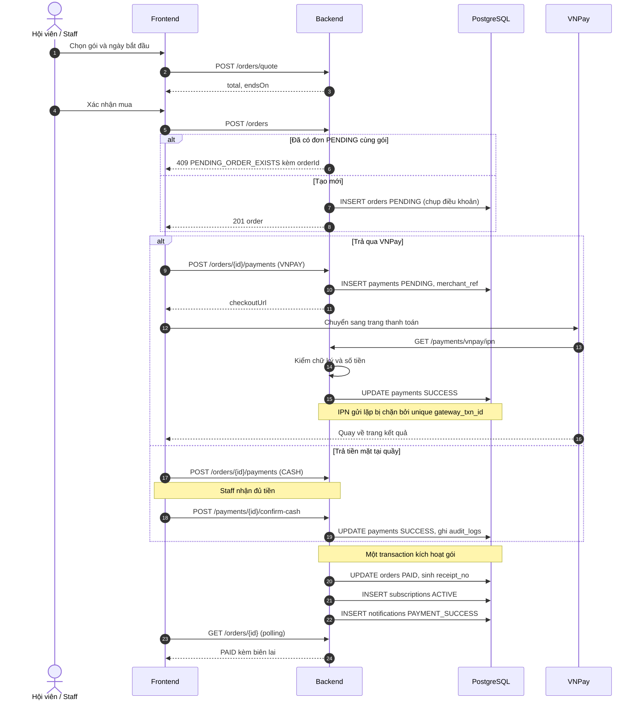
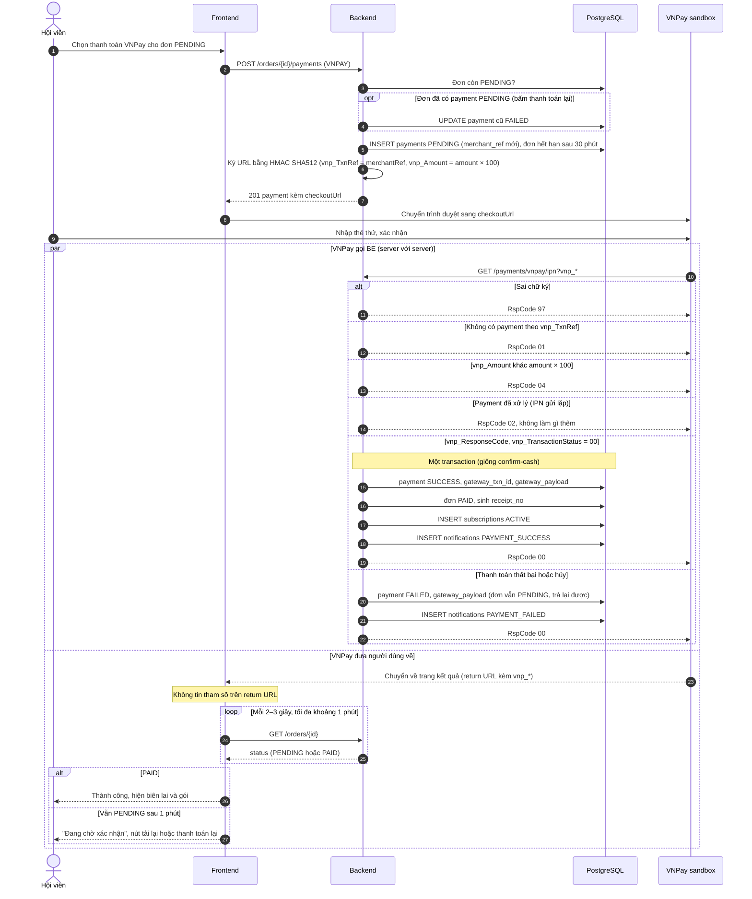
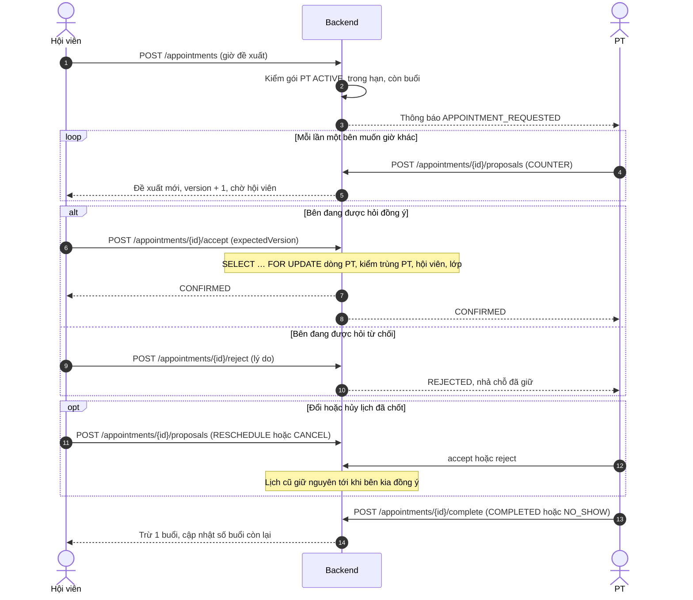
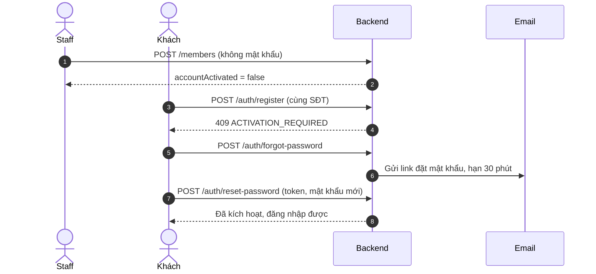

# Sơ đồ tuần tự các luồng khó

- **Ai sở hữu:** Triển (thanh toán, lịch PT), Hồng Anh (kích hoạt tài khoản). **Khi nào cập nhật:** khi luồng hoặc API đổi.
- Bảng từng bước của các luồng nằm ở mục 12 tài liệu Tiến hành công việc.

## Mua gói và thanh toán (UC09, UC12, UC13)

## VNPay: tạo thanh toán, IPN và trang kết quả (UC12)

Chi tiết hơn nhánh "Trả qua VNPay" ở trên. Nguồn: `docs/api/openapi.yaml` (`POST /orders/{id}/payments`, `GET /payments/vnpay/ipn`, `GET /orders/{id}`).

- IPN có thể tới **trước hoặc sau** khi người dùng về trang kết quả; FE chỉ dựa vào `GET /orders/{id}`.
- Chống tạo gói hai lần: unique `gateway_txn_id` và "một payment SUCCESS mỗi đơn" (ERD v3). Phải có test IPN gửi lặp và gửi song song (`docs/team/roles/be-lead.md` mục 6).
- Response IPN luôn HTTP 200 theo định dạng VNPay `{ RspCode, Message }`, không theo dạng lỗi chung.
- Quá 30 phút không có IPN thành công: job 5 phút chuyển đơn `EXPIRED`, payment PENDING → FAILED (quyết định 9, 17).
- Chưa chốt (Q17d): IPN báo thành công cho payment đã FAILED vì bị thay bằng lần thanh toán mới.

## Thương lượng lịch PT (UC23–UC27)

## Kích hoạt tài khoản tạo tại quầy (UC20, UC01, UC04)

